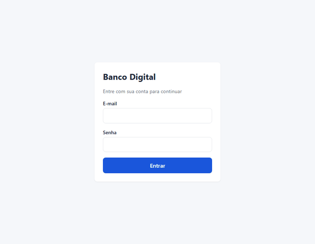
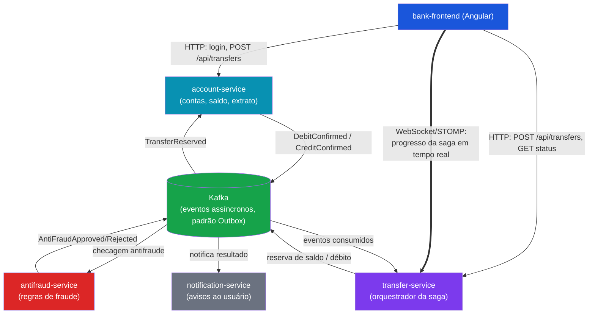
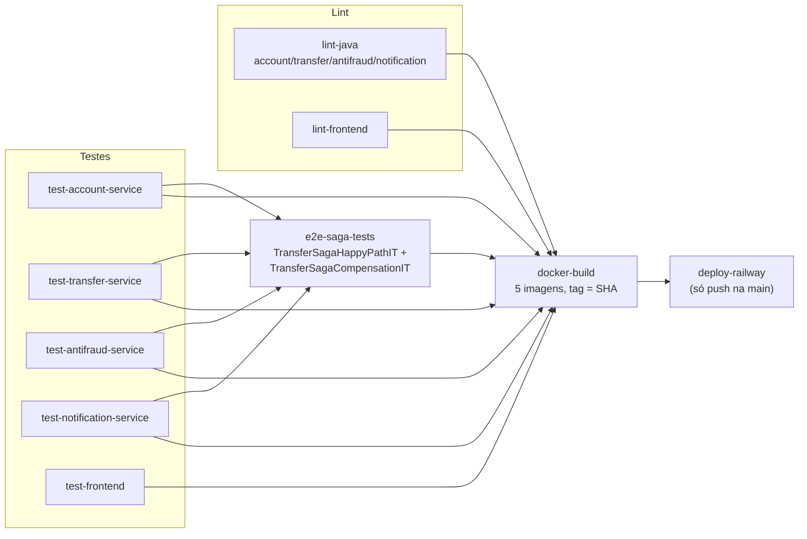

# Banco Digital — Transferências com Saga Pattern

[](https://github.com/lleolopes03/banco-digital-saga/actions/workflows/ci.yml)


Simulação de um banco digital com contas, depósitos e transferências. Toda transferência
é orquestrada por uma saga: reserva de saldo → checagem antifraude → confirmação de débito →
crédito no destinatário. Falhas em qualquer etapa disparam transações compensatórias que
devolvem o dinheiro à conta de origem (rollback via saga, não via transação de banco de dados).

Três microsserviços Spring Boot orquestram a saga da transferência e se coordenam via Kafka
(padrão Outbox) sem nenhuma chamada síncrona entre si; um quarto (`notification-service`) reage
ao resultado da saga registrando notificações em MongoDB. Um frontend Angular acompanha o
progresso da saga em tempo real via WebSocket/STOMP, e todo o sistema é validado a cada push por
um pipeline de CI que sobe Postgres/MongoDB/Kafka/Redis efêmeros via Testcontainers — sem
depender de nenhum ambiente Docker local.

## Demonstração

Uma transferência, do formulário até a conclusão — e uma segunda transferência acima do limite
antifraude, mostrando a compensação da saga (estorno) refletida ao vivo no frontend:



## Destaques técnicos

- **Saga orquestrada com compensação real** — não é rollback de transação de banco; cada etapa
  (reserva, antifraude, débito, crédito) tem sua própria compensação, disparada por evento.
- **Padrão Outbox + propagação de trace através do Kafka** — nenhum evento se perde entre a
  transação de negócio e a publicação, e a saga inteira aparece como **um único trace** no
  Jaeger, mesmo cruzando a fronteira assíncrona do Kafka várias vezes.
- **Resiliência provada por teste, não só documentada**: circuit breaker (Resilience4j) na única
  chamada síncrona do sistema, dead-letter queue nos quatro serviços com consumer Kafka,
  idempotência via Redis + fonte de verdade durável — cada mecanismo tem um teste de integração
  com infraestrutura real (Testcontainers) provando que funciona, não só que existe.
- **Observabilidade completa**: tracing distribuído (OpenTelemetry → Jaeger), métricas
  customizadas (Micrometer → Prometheus → Grafana), dashboard provisionado automaticamente sem
  passo manual.
- **Segurança**: JWT com blacklist de logout compartilhada via Redis entre serviços, autorização
  por dono da conta em todo endpoint escopado.
- **Modelagem poliglota justificada**: PostgreSQL nos serviços transacionais da saga, MongoDB no
  serviço de notificações — decisão de banco por formato de dados e padrão de acesso, não por
  hábito (ver [Notificações](#notificações-mongodb)).
- **Tempo real sem polling**: WebSocket/STOMP autenticado no frame (não no handshake HTTP, que
  não suporta isso), com fallback automático de polling se a conexão cair.
- **CI/CD sem depender de infraestrutura local**: todo teste sobe Postgres/MongoDB/Kafka/Redis
  efêmeros via Testcontainers direto no runner do GitHub Actions; um gate end-to-end da saga
  bloqueia o deploy se a compensação quebrar.

## Índice

- [Stack](#stack)
- [Arquitetura](#arquitetura)
- [Princípios de design (Clean Code e SOLID)](#princípios-de-design-clean-code-e-solid)
- [Estrutura do repositório](#estrutura-do-repositório)
- [Subindo o ambiente](#subindo-o-ambiente)
- [Resiliência: circuit breaker na validação síncrona de saldo](#resiliência-circuit-breaker-na-validação-síncrona-de-saldo)
- [Resiliência: dead-letter queue (DLQ) nos consumers Kafka](#resiliência-dead-letter-queue-dlq-nos-consumers-kafka)
- [Autenticação](#autenticação)
- [Transferência em tempo real (WebSocket/STOMP)](#transferência-em-tempo-real-websocketstomp)
- [Tracing distribuído da saga (OpenTelemetry)](#tracing-distribuído-da-saga-opentelemetry)
- [Antifraude](#antifraude)
- [Notificações (MongoDB)](#notificações-mongodb)
- [Publicação do Outbox, partições e escala horizontal](#publicação-do-outbox-partições-e-escala-horizontal)
- [Retenção de dados (Outbox e idempotência)](#retenção-de-dados-outbox-e-idempotência)
- [CI/CD](#cicd)

## Stack

- **Backend**: Java 21, Spring Boot 4.1 (o Initializr não oferece mais a linha 3.x — ver nota
  abaixo), Maven, PostgreSQL, Flyway, MongoDB (notification-service — ver seção "Notificações"),
  Kafka (modo KRaft), Redis, Resilience4j, WebSocket/STOMP, springdoc-openapi (Swagger UI)
- **Frontend**: Angular 19 standalone, TypeScript, `@stomp/stompjs` (acompanhamento da saga em
  tempo real), ESLint
- **Testes**: JUnit 5, Mockito, Testcontainers (postgresql, mongodb, kafka, redis), Karma/Jasmine
  (frontend), um módulo `e2e-tests` dedicado que sobe os três serviços da saga (e, no teste do
  caminho feliz, também o notification-service) na mesma JVM contra infraestrutura real
- **Observabilidade**: OpenTelemetry (tracing distribuído via otel-collector → Jaeger) +
  Micrometer/Prometheus (métricas) + Grafana (dashboard)
- **CI/CD**: GitHub Actions (lint, testes com containers efêmeros, build de imagens Docker,
  deploy no Railway — ver seção [CI/CD](#cicd) abaixo), Spotless (Java), ESLint (frontend)
- **Infra local**: Docker Compose

> **Nota sobre a versão do Spring Boot**: a stack original pedia Spring Boot 3.x, mas o
> start.spring.io não gera mais projetos nessa linha (mínimo atual é 4.0). Optou-se por usar a
> versão atual (4.1.0) em vez de fixar manualmente uma versão fora de suporte do initializr.

## Arquitetura



Cada serviço da saga tem seu próprio PostgreSQL; `notification-service` é a exceção — usa
MongoDB (ver seção "Notificações" mais abaixo). Redis é compartilhado pelos quatro serviços
backend para idempotência de consumers Kafka, além de cache/lock da saga (account/transfer) e
checagem da blacklist de logout do JWT (account/transfer/notification). Os quatro serviços
exportam traces via OpenTelemetry para um otel-collector, que repassa pro Jaeger — e expõem
métricas Prometheus em `/actuator/prometheus`, visualizadas num dashboard Grafana (ver "Tracing
distribuído da saga" mais abaixo). A conexão WebSocket/STOMP do
frontend com o `transfer-service` é autenticada por JWT no frame `CONNECT` (não no handshake
HTTP, que não suporta header customizado) e autorizada por assinatura — só quem é dono da conta
de origem/destino pode acompanhar aquela transferência específica.

### Fluxo da saga de transferência

1. **Reserva de saldo** — `transfer-service` pede ao `account-service` para reservar o valor
   na conta de origem.
2. **Checagem antifraude** — `transfer-service` publica um evento no Kafka para o
   `antifraud-service` avaliar a transferência.
3. **Confirmação de débito** — se aprovado, `transfer-service` confirma o débito na conta de
   origem.
4. **Crédito no destinatário** — `account-service` credita a conta de destino.
5. **Compensação (rollback)** — se qualquer etapa falhar (reserva, antifraude ou crédito), o
   `transfer-service` dispara uma transação compensatória que devolve o valor reservado/debitado
   à conta de origem. `notification-service` informa o usuário do resultado (sucesso ou
   estorno).

**Falha rápida na reserva**: quando o `account-service` não consegue reservar o saldo
(`SALDO_INSUFICIENTE`), ele publica `TransferReservationFailed` no mesmo tópico de
`TransferReserved` (distinguido pelo header `eventType`). O `transfer-service` falha a saga na
hora, registra o motivo real em `failureReason` e publica `TransferFailed` para o
`notification-service`, em vez de esperar o timeout da saga. Se a saga já tiver sido falhada pelo
timeout ou já tiver avançado de estado, o evento é ignorado.

## Princípios de design (Clean Code e SOLID)

| Princípio | Onde aparece |
|---|---|
| **Responsabilidade única** | `AccountService` (casos de uso HTTP) × `AccountSagaService` (passos da saga); `TransferInitiationService` (abre a transferência) × `SagaOrchestratorService` (conduz a saga) × `TransferQueryService` (consulta); `OutboxPublisherScheduler` (ciclo reivindicar-enviar-confirmar) × `OutboxRecordFactory` (registro Kafka e roteamento de tópico). |
| **Aberto/fechado** | Um novo tipo de evento é um novo `record` em `domain.event`, uma linha em `TOPICO_POR_EVENTO` (produtor) e um `.quando(...)` no `EventRouter` do consumer, sem editar `switch`. O `eventType` é o nome da classe do evento, então não há texto de tipo no código de produção; `EventTypeContractTest` é o único lugar que o fixa e falha se um `record` for renomeado. O ciclo de vida da saga é dado (`SagaStateMachine`), não `if`s espalhados. |
| **Inversão de dependência** | `BalanceCache` é um porto da camada de aplicação; `RedisBalanceCache` (infraestrutura) é o adaptador. O caso de uso decide *quando* ler, gravar e invalidar sem saber que o armazenamento é Redis, e os testes unitários usam um mock simples. |
| **Segregação de interfaces** | Portos pequenos e focados (`BalanceCache`: buscar, guardar, invalidar) em vez de depender de um cliente Redis inteiro. |
| **Não se repetir** | `OutboxEventWriter` / `SagaOutboxPublisher` (serialização, traceparent, tipo do evento), `@RetryOnOptimisticLock` (a política de retry em um lugar só), `EventPayloadReader` (desserialização dos consumers) e `executarPasso` (transação + invalidação de cache depois do commit). |
| **Clean Code** | Nomes que dizem a intenção (`liberacaoDeReservaSolicitada`, `falharSaga`, `compensar`); métodos curtos; handlers da saga sem blocos copiados; comentários explicam o *porquê* (concorrência, ordem de commit e cache, entrega *at-least-once*), não o *quê*. |

**Convenção de nomes.** Regras de negócio e casos de uso em português (`reservar`, `liberarReserva`,
`Account.abrir`, `depositar`); vocabulário técnico de padrões em inglês (Outbox, Scheduler, Factory,
Writer, Router). Valores persistidos ou publicados (`TransactionType`, nomes de evento) não mudam
com a convenção, para não quebrar dados e contratos existentes.

`RetryOnOptimisticLockTest` prova que a meta-anotação realmente aciona o retry do spring-retry
(sem ele, um conflito de lock deixaria de ser reexecutado e nenhum outro teste perceberia).

**Duplicação deliberada entre serviços.** `OutboxEvent`, `ProcessedEvent`, `IdempotentEventHandler`,
`SagaObservability`, `KafkaErrorHandlingConfig` e `EventPayloadReader` existem uma vez em cada
serviço. É uma troca consciente: cada serviço é um deploy independente, com build e imagem Docker
próprios, e compartilhar uma biblioteca acoplaria versões e o pipeline de todos. O custo é replicar
correções à mão. Com mais serviços, o passo natural é extrair um módulo `bank-commons` publicado
num repositório de artefatos.

## Estrutura do repositório

```
/account-service        Spring Boot — contas, saldo, extrato (Dockerfile próprio)
/transfer-service        Spring Boot — orquestrador da saga + WebSocket/STOMP (Dockerfile próprio)
/antifraud-service       Spring Boot — validação de regras de fraude (Dockerfile próprio)
/notification-service    Spring Boot — notificações, persistidas em MongoDB (envio real via
                          Anthropic API / Z-API no futuro)
/bank-frontend            Angular — UI (Dockerfile próprio, build servido via nginx)
/e2e-tests                Harness de teste ponta a ponta da saga (happy path + compensação),
                          roda os três serviços da saga na mesma JVM contra infra real
/docs                     Assets de portfólio (gif de demonstração)
/.github/workflows/ci.yml Pipeline de CI/CD (ver seção "CI/CD" abaixo)
docker-compose.yml        Infra local (Kafka, Postgres x3, MongoDB, Redis, Jaeger, Prometheus, Grafana)
.env.example               Variáveis de ambiente usadas pelos serviços
```

Cada `*-service` segue a mesma organização de pacotes:

```
src/main/java/com/bancodigital/<servico>/
├── domain/            entidades e regras de domínio
├── application/       casos de uso / services
├── infrastructure/
│   ├── persistence/    repositories (JPA nos três serviços da saga; MongoDB no notification-service)
│   └── messaging/       producers/consumers Kafka
└── web/
    ├── controller/
    └── dto/
```

## Subindo o ambiente

### 1. Infraestrutura

Copie `.env.example` para `.env` e ajuste se necessário, depois:

```bash
docker compose up -d
```

Isso sobe:

| Serviço | Porta |
|---|---|
| Kafka (KRaft) | `9092` |
| PostgreSQL (account) | `5442` (db `account_db`) |
| PostgreSQL (transfer) | `5443` (db `transfer_db`) |
| PostgreSQL (antifraud) | `5434` (db `antifraud_db`) |
| MongoDB (notification) | `27018` (db `notification_db`) |
| Redis | `6379` |
| Jaeger UI | `16686` |
| otel-collector | `4317` (OTLP gRPC) / `4318` (OTLP HTTP) — quem recebe traces dos serviços agora, repassa pro Jaeger internamente |
| Prometheus | `9090` |
| Grafana | `3000` (usuário `admin`/senha `admin`, ou acesso anônimo como Viewer) |

> `notification-service` usa MongoDB, não Postgres: cada notificação é um documento cujo schema
> varia por canal (`EMAIL`, `PUSH`, `SMS`), o que mapearia mal numa tabela relacional. É o único
> banco não-Postgres do projeto.

> **Nota sobre portas**: `account` e `transfer` usariam `5432`/`5433` por padrão, mas nesta
> máquina já existe um PostgreSQL nativo do Windows ocupando essas duas portas (o mesmo problema
> documentado no projeto `convite_casamento` vizinho). Por isso eles foram remapeados para
> `5442`/`5443`, e o MongoDB do notification-service (padrão `27017`) foi remapeado para `27018`
> pelo mesmo motivo preventivo. Se a sua máquina não tiver esse conflito, ajuste livremente em
> `docker-compose.yml`, `.env.example` e nos respectivos `application-dev.yml`.

### 2. Backends

Cada serviço roda no profile `dev` (aponta para os containers acima):

```bash
cd account-service
./mvnw spring-boot:run -Dspring-boot.run.profiles=dev
```

Repita para `transfer-service`, `antifraud-service` e `notification-service` (portas `8081` a
`8084`, respectivamente).

Para rodar os testes (usa Testcontainers via `@ServiceConnection`, não depende do
`docker compose up`):

```bash
./mvnw test
```

#### Documentação da API (Swagger)

Cada serviço com endpoint HTTP expõe Swagger UI (gerado por `springdoc-openapi` a partir dos
`@RestController`/DTOs já existentes, sem anotação extra) e a spec OpenAPI crua:

| Serviço | Swagger UI | OpenAPI JSON |
|---|---|---|
| account-service | http://localhost:8081/swagger-ui.html | http://localhost:8081/v3/api-docs |
| transfer-service | http://localhost:8082/swagger-ui.html | http://localhost:8082/v3/api-docs |
| notification-service | http://localhost:8084/swagger-ui.html | http://localhost:8084/v3/api-docs |

A página carrega sem autenticação, mas os endpoints continuam exigindo JWT — clique em
**Authorize** e cole um token (`POST /api/auth/login` no account-service) para usar o "Try it
out" nos endpoints protegidos. `antifraud-service` não está na lista: não expõe nenhum endpoint
HTTP (só participa da saga via Kafka — ver "Antifraude" abaixo), então uma spec OpenAPI ali
estaria sempre vazia.

### 3. Frontend

```bash
cd bank-frontend
npm install
npm run dev
```

Sobe em `http://localhost:4200`, com proxy configurado (`proxy.conf.json`) para `account-service`
(`:8081`) e `transfer-service` (`:8082`, incluindo o endpoint WebSocket `/ws`) — evita precisar de
CORS em qualquer um dos dois serviços. Rotas disponíveis:

| Rota | Protegida por `authGuard`? | Descrição |
|---|---|---|
| `/login` | Não | Formulário reativo, redireciona para `/dashboard` no sucesso |
| `/dashboard` | Sim | Saldo atual + atalhos para extrato e nova transferência |
| `/extrato` | Sim | Extrato paginado, filtro por período, cores por tipo de movimentação |
| `/transferencia` | Sim | Formulário de nova transferência |
| `/transferencia/:transferId/status` | Sim | Stepper visual acompanhando a saga ao vivo (ver seção abaixo) |

Testes unitários (Karma/Jasmine): `npm test`. Lint (ESLint): `npm run lint` (ou `ng lint`).

## Resiliência: circuit breaker na validação síncrona de saldo

A comunicação entre serviços é majoritariamente assíncrona via Kafka (resiliente por natureza:
uma partição sem consumidor não derruba quem publica). A única chamada síncrona do sistema é uma
otimização em `transfer-service`: antes de abrir uma saga inteira (`POST /api/transfers`), ele
consulta `GET /api/accounts/{id}/balance` no `account-service` via `RestClient`, para recusar de
cara (`422 Unprocessable Entity`) um caso óbvio de saldo insuficiente sem gastar uma saga completa
com isso. A chamada repassa o JWT de quem está criando a transferência (header `Authorization`
da requisição corrente), porque o `account-service` exige autenticação nessa rota — sem isso a
pré-checagem voltaria sempre `401` e cairia no fallback sem ninguém notar.

Essa chamada é protegida por um circuit breaker Resilience4j (`AccountServiceClient`, em
`transfer-service/src/main/java/com/bancodigital/transfer/infrastructure/client/`):

- **Fechado (padrão)**: chama o account-service normalmente.
- **Aberto** (`transfer-service/src/main/resources/application.yml`, instância `accountService`:
  janela de 10 chamadas, abre com 50% de falha, fica aberto por 10s): pula direto para o
  fallback, **sem** tentar a chamada de rede.
- **Fallback (`balanceCheckFallback`)**: nunca bloqueia o usuário. Ele simplesmente devolve
  "saldo desconhecido" e deixa a saga ser criada normalmente — a validação definitiva de saldo é
  a reserva assíncrona (etapa 1 da saga), que independe desta chamada síncrona.

Métricas em tempo real:

```
GET http://localhost:8082/actuator/health           # mostra o CircuitBreakerHealthIndicator
GET http://localhost:8082/actuator/circuitbreakers   # estado, contagem de chamadas, taxa de falha
```

### Teste manual: derrubando o account-service e observando o circuito abrir

O mesmo comportamento (chamada normal → falhas abrindo o circuito → fallback sem bloquear a saga
→ half-open tentando a chamada real de novo) é coberto automaticamente por
`TransferServiceCircuitBreakerTest` (WireMock simulando o account-service), sem precisar derrubar
nada manualmente — o roteiro abaixo é só para ver o mesmo efeito ao vivo.

<details>
<summary>Passo a passo (clique para expandir)</summary>

Neste repositório o `account-service` roda como processo local (`./mvnw spring-boot:run`), não
como container — ajuste o passo 2 caso você tenha containerizado os serviços.

1. Suba a infraestrutura (`docker compose up -d`) e os quatro serviços em profile `dev`
   (`account-service` na porta `8081`, `transfer-service` na `8082`).
2. Confirme o circuito fechado:
   ```bash
   curl http://localhost:8082/actuator/circuitbreakers
   # "accountService": { "state": "CLOSED", ... }
   ```
3. Derrube o `account-service` (Ctrl+C no terminal onde ele roda, ou `docker stop
   <container-do-account-service>` se estiver containerizado).
4. Dispare pelo menos 10 transferências para forçar a avaliação da janela deslizante:
   ```bash
   for i in $(seq 1 10); do
     curl -s -o /dev/null -w "%{http_code}\n" -X POST http://localhost:8082/api/transfers \
       -H "Content-Type: application/json" \
       -d '{"accountOrigemId":"'$(uuidgen)'","accountDestinoId":"'$(uuidgen)'","valor":100.00}'
   done
   ```
   Todas devem responder `202 Accepted` — o fallback deixa a saga seguir mesmo sem o
   account-service no ar.
5. Confirme o circuito aberto:
   ```bash
   curl http://localhost:8082/actuator/circuitbreakers
   # "accountService": { "state": "OPEN", "failureRate": "100.0%", ... }
   ```
6. Suba o `account-service` de novo, espere ~10s (`waitDurationInOpenState`) e repita o passo 2:
   o estado deve ter voltado para `HALF_OPEN` e, após chamadas bem-sucedidas, para `CLOSED`.

</details>

## Resiliência: dead-letter queue (DLQ) nos consumers Kafka

Kafka processa mensagens em ordem dentro de uma partição. Se um `@KafkaListener` recebe uma
mensagem que falha de forma **permanente** (payload corrompido, uma transição rejeitada pela
`SagaStateMachine`) e simplesmente entra em loop de retry, nenhuma mensagem publicada depois dela
naquela partição é processada — uma "poison pill" trava a fila inteira, não só o item problemático.

Os quatro serviços com `@KafkaListener` de verdade (`account-service`, `transfer-service`,
`antifraud-service` e, desde a fatia de notificações, `notification-service`) registram um
`DefaultErrorHandler` com `DeadLetterPublishingRecoverer` (`KafkaErrorHandlingConfig`, em
`infrastructure/messaging` de cada um): até 3 tentativas (1 inicial + 2 retries, 1s de backoff
entre elas — deliberadamente curto, para não competir com o timeout de 2 minutos do
`SagaTimeoutScheduler`, que é a rede de segurança maior para sagas travadas). Esgotadas as
tentativas, a mensagem é desviada para o tópico `<topico-original>-dlt` (sufixo padrão desta
versão do Spring Kafka — **não** `.DLT`, como a maioria da documentação mais antiga descreve) e o
consumer segue processando as próximas normalmente. O Spring Boot injeta esse error handler
automaticamente em todos os `@KafkaListener` do serviço assim que o bean existe, sem precisar
configurar cada consumer individualmente.

| Serviço | Consumers cobertos | Por que importa |
|---|---|---|
| `account-service` | `TransferRequestedConsumer`, `DebitConfirmationRequestedConsumer`, `CreditRequestedConsumer`, `TransferCompensateConsumer` | É quem move dinheiro de fato (reserva/débito/crédito) — uma partição travada aqui trava o núcleo da saga |
| `transfer-service` | os cinco consumers do orquestrador (`TransferReservedConsumer`, `AntiFraudEventConsumer`, `DebitConfirmedConsumer`, `CreditConfirmedConsumer`, `TransferCompensatedConsumer`) | Sem isso, uma mensagem travada aqui trava a orquestração inteira da saga |
| `antifraud-service` | `TransferReservedConsumer` | Menor superfície, mas sem DLQ uma falha permanente trava toda avaliação de fraude subsequente |
| `notification-service` | `TransferFinishedConsumer` | Único consumer do serviço, mas sem DLQ uma falha permanente pararia todo o histórico de notificações |

Cada um dos quatro serviços tem um `KafkaErrorHandlingConfigTest` (Kafka real via Testcontainers,
mesmo grupo de consumer usado em produção): publica um payload que falha na deserialização em
toda tentativa e confirma que a mensagem aparece no tópico `-dlt` correspondente — prova de que o
error handler está de fato ligado ao container dos listeners, não só declarado.

**Próximo passo consciente**: hoje as mensagens na DLQ ficam só armazenadas, visíveis e não
perdidas, mas sem reprocessamento automático nem alerta. Um consumer dedicado lendo da DLT — para
reprocessamento manual após corrigir a causa raiz, ou alimentando um contador Prometheus
(`kafka_dlt_messages_total`) que dispara alerta no Grafana — é a evolução natural, aproveitando a
stack de observabilidade que já existe.

## Autenticação

`account-service`, `transfer-service` e `notification-service` exigem um JWT válido em toda rota
que não seja `/api/auth/**` ou `/actuator/health` (`SecurityConfig` de cada serviço).
`antifraud-service` continua sem autenticação — não expõe nenhum endpoint HTTP consumido pelo
frontend, só participa da saga via Kafka.

### Login, logout e blacklist

- **`POST /api/auth/login`** (só existe no `account-service`, dono da tabela `users`): recebe
  `email`/`senha`, valida a senha com BCrypt e devolve um JWT HS256 de **15 minutos** com claims
  `sub` (userId), `accountId` e `jti` (id único do token).
- **`POST /api/auth/logout`**: extrai o `jti` e a expiração do token recebido e grava
  `jwt:blacklist:<jti>` no Redis com TTL igual ao tempo de validade **restante** do token — a
  entrada some sozinha do Redis exatamente quando o token expiraria de qualquer forma.
- **`JwtAuthenticationFilter`** (duplicado em `account-service`, `transfer-service` e
  `notification-service`, mesma convenção de duplicação entre serviços já usada para
  `OutboxEvent`/`ProcessedEvent`): valida a assinatura do token e, antes de autorizar, confere se
  o `jti` está na blacklist do Redis. Os três serviços apontam para a mesma instância Redis
  (`docker-compose.yml`) e compartilham o segredo de assinatura via `JWT_SECRET`, então um logout
  feito no `account-service` também invalida o token nos outros dois imediatamente.

### Autorização por conta

Todo endpoint escopado por conta valida que o `accountId` do token bate com o `accountId` da
requisição, devolvendo `403` caso contrário:

| Serviço | Endpoint | Conta verificada |
|---|---|---|
| account-service | `GET/POST /api/accounts/{id}...` (balance, deposits, statement, busca por id) | `{id}` da URL |
| transfer-service | `POST /api/transfers` | `accountOrigemId` do corpo |
| notification-service | `GET /api/notifications/{accountId}` | `{accountId}` da URL |

`GET /api/transfers/{id}` continua exigindo apenas um JWT válido (não verifica se o chamador é
dono da conta de origem/destino da saga) — ver "Próximos passos" abaixo.

### Próximos passos

- **Refresh token**: esta fatia usa só um access token de 15 minutos, sem refresh — o usuário
  precisa logar de novo quando expirar. Ainda não implementado.
- **Ownership em `GET /api/transfers/{id}`**: hoje qualquer usuário autenticado pode consultar
  qualquer saga pelo id, sem checar se é a conta de origem/destino.
- **Signup**: não há endpoint de cadastro de usuário nesta fatia — `User` só é criado diretamente
  no banco (ver testes `*IT`). `POST /api/accounts` exige um JWT válido, mas não precisa ser de um
  usuário já vinculado àquela conta (abrir uma nova conta não tem `{accountId}` para validar
  contra).

## Transferência em tempo real (WebSocket/STOMP)

A tela de transferência (`/transferencia`) acompanha o progresso da saga ao vivo, sem polling —
é o maior diferencial visual do projeto (ver GIF na seção "Demonstração" no topo deste README).

### Backend

`transfer-service` expõe um endpoint STOMP em `/ws` (`WebSocketConfig`, broker simples em
`/topic`). Depois de cada transição de estado da `SagaInstance` (nos mesmos pontos onde os
consumers Kafka já persistiam o novo status — Fatias 7 e 8), o `SagaOrchestratorService` publica
um `SagaStatusUpdate` (status atual + `failureReason`, se houver) em
`/topic/transfers/{transferId}` via `SagaStatusPublisher`. A publicação é best-effort — se
ninguém estiver assinando naquele instante, a mensagem se perde e o fallback de polling do
frontend (abaixo) cobre o caso.

**Autenticação e autorização da conexão**: um WebSocket nativo do browser não permite anexar um
header `Authorization` no handshake HTTP inicial — por isso `/ws/**` é liberado no
`SecurityConfig`, e a autenticação de verdade acontece no frame STOMP `CONNECT`
(`StompAuthChannelInterceptor`), lendo o JWT de um header STOMP nativo (não HTTP). O mesmo
interceptor autoriza cada `SUBSCRIBE`: só quem é dono da conta de origem ou destino daquela
transferência pode assinar seu tópico.

### Frontend

`TransferStatusService` encapsula a conexão STOMP (`@stomp/stompjs`) atrás de um
`Observable<SagaStatusUpdate>`. `TransferStatusComponent` monta um stepper com 5 passos
(reservando → antifraude → débito → crédito → concluída); cada mensagem recebida atualiza o
estado visual do passo correspondente, e uma falha/compensação pinta o passo relevante de
vermelho com o `failureReason` recebido. A conexão fecha sozinha (`client.deactivate()`) quando a
saga chega a um estado terminal (`COMPLETED`/`FAILED`) ou quando o componente é destruído — nunca
fica aberta além do necessário.

**Fallback de polling**: se a conexão WebSocket cair ou nunca se estabelecer, o componente
detecta (erro ou `complete()` sem status terminal) e passa a consultar
`GET /api/transfers/{id}` a cada 2 segundos até atingir um status terminal — a UI mostra
claramente qual dos dois modos está ativo ("Acompanhando em tempo real" vs. "Atualizando a cada
2s").

## Tracing distribuído da saga (OpenTelemetry)

Uma transferência atravessa `account-service` → Kafka → `transfer-service` → Kafka →
`antifraud-service` → Kafka → `transfer-service` → Kafka → `account-service` → Kafka →
`transfer-service`, seis vezes cruzando a fronteira assíncrona do Kafka. Sem propagação
explícita de contexto, cada hop viraria um trace novo e desconectado no Jaeger — o objetivo
desta fatia é que a saga inteira apareça como **um único trace**, do `POST /api/transfers` até a
etapa final (conclusão ou compensação).

### Arquitetura

```
account-service ────┐
transfer-service ────┼── OTLP (HTTP :4318) ──► otel-collector ──► Jaeger (:16686)
antifraud-service ───┤                              │
notification-service ┘                              ▼
                                        (só traces — métricas não passam
                                         pelo collector, ver abaixo)

account-service ────┐
transfer-service ────┼── scrape /actuator/prometheus ──► Prometheus (:9090) ──► Grafana (:3000)
antifraud-service ───┤
notification-service ┘
```

O `otel-collector` (`otel/opentelemetry-collector-contrib`, config em
`observability/otel-collector-config.yaml`) existe como uma camada extra entre os serviços e o
Jaeger — recebe OTLP de todos os quatro e repassa em lote, em vez de cada serviço falar direto
com o Jaeger. Métricas usam um caminho totalmente separado (scrape do Prometheus em
`/actuator/prometheus`, não push OTLP) — mais simples de depurar e é o modelo padrão do
ecossistema Prometheus/Grafana. `notification-service` só entrou nesses dois caminhos na fatia
de notificações (antes era um esqueleto sem código de negócio nenhum para tracear).

**Armazenamento e amostragem**: o Jaeger sobe com armazenamento em disco (Badger, volume
`jaeger_data`) e retenção de 72h, não mais em memória sem limite — medido em carga, cada trace
ocupava ~120 KB de RAM e o container passava de 2 GB depois de ~15 mil sagas. O container tem
`mem_limit: 1g` e o `otel-collector` tem `memory_limiter`, então um backend lento faz o coletor
recusar spans em vez de crescer até cair. Em desenvolvimento 100% dos traces são amostrados;
`TRACING_SAMPLING_PROBABILITY` (ex.: `0.1`) reduz isso sem mexer no código. Em produção o ideal é
um backend gerenciado (Elasticsearch/OpenSearch) e amostragem na borda.

> **Pegadinha do Spring Boot 4.1**: a propriedade `management.otlp.tracing.endpoint` (válida até
> a linha 3.x) foi renomeada para `management.opentelemetry.tracing.export.otlp.endpoint`. Usar o
> nome antigo não dá erro nenhum — o app sobe normalmente e simplesmente não exporta trace
> nenhum, silenciosamente. Ver `application-dev.yml` dos quatro serviços.

### Propagação através do Kafka (padrão Outbox)

Cada evento gravado no Outbox (`OutboxEvent`, ver Fatia 4) agora carrega uma coluna
`trace_context` com o `traceparent` (W3C) capturado no momento da criação do evento — **nunca**
no `OutboxPublisherScheduler`, que roda numa thread de scheduling sem nenhuma relação com a
transação original. A classe `SagaObservability` (duplicada por serviço, mesma convenção já
usada para `OutboxEvent`/`ProcessedEvent`) concentra essa lógica:

- `traceparentAtual()` — injeta `Context.current()` num carrier `Map<String,String>` via
  `OpenTelemetry.getPropagators().getTextMapPropagator()` e devolve a string `traceparent`.
  Chamada dentro do método de negócio que cria o `OutboxEvent` (ex.: `AccountService.criarOutboxEvent`).
- `injetarHeader(record, traceContext)` — copia essa string (já capturada, sem reinjetar) como
  header Kafka literal, chamada pelo `OutboxPublisherScheduler` na hora de publicar.
- `executarEtapa(etapa, traceparentRecebido, atributos, ação)` — do lado do consumer: extrai o
  `Context` do header `traceparent` recebido (`@Header(value = "traceparent", required = false)`
  em todo `@KafkaListener`), abre um span `saga.<etapa>` como filho desse contexto, seta os
  atributos, roda a ação dentro do escopo do span, e registra a duração num Timer Micrometer —
  tudo num só lugar, então tracing e métricas de latência nunca ficam dessincronizados.

Se o header vier ausente/nulo (evento antigo, ou publicado fora desse fluxo), o span simplesmente
começa um trace novo em vez de falhar — a propagação é best-effort, nunca bloqueia a saga.

`notification-service` só consome eventos (nunca publica via Outbox), então sua versão de
`SagaObservability` não tem `traceparentAtual()`/`injetarHeader()` — só `executarEtapa()`, do
lado consumer.

### Spans customizados

| Span | Serviço | Onde |
|---|---|---|
| `saga.reserve` | account-service | `TransferRequestedConsumer` → `AccountService.reservarSaldo` |
| `saga.antifraud_check` | antifraud-service | `TransferReservedConsumer` → `AntiFraudService.avaliar` |
| `saga.debit` | account-service | `DebitConfirmationRequestedConsumer` → `AccountService.confirmarDebito` |
| `saga.credit` | account-service | `CreditRequestedConsumer` → `AccountService.creditarPorTransferencia` |
| `saga.compensate` | account-service | `TransferCompensateConsumer` → `liberarReserva`/`reverterDebito` (os dois cenários de compensação) |
| `saga.notify` | notification-service | `TransferFinishedConsumer` → `NotificationService.registrarTransferConcluida`/`registrarTransferFalhou` |

Cada um carrega os atributos `transferId` e `valor` (nunca CPF/nome — ver "Sanitização" abaixo).
Os cinco consumers do `transfer-service` (que só orquestram, não executam a etapa de negócio em
si) também propagam o trace e abrem spans próprios (`saga.orchestrate.reserve_ack`,
`.antifraud_result`, `.debit_ack`, `.credit_result`, `.compensation_ack`) para que **nenhum** hop
da saga quebre o trace — não só os cinco nomeados acima.

### Sanitização

Nenhum span/atributo customizado carrega `ownerName`/`ownerDocument` (CPF) ou dado de login
(`email`/`senha`) — só IDs (`transferId`) e valores agregados (`valor`). Os spans HTTP
auto-instrumentados (Spring MVC/RestClient, via `spring-boot-starter-opentelemetry`) seguem as
convenções semânticas padrão do OTel (método, rota, status code) e não serializam corpo de
requisição/resposta.

### Métricas Prometheus

Cada serviço expõe `/actuator/prometheus` (liberado no `SecurityConfig` de account-service,
transfer-service e notification-service, igual a `/actuator/health` — o Prometheus não carrega
JWT nenhum ao fazer scrape):

- `saga_transfers_total{status="COMPLETED"|"FAILED"}` — contador, incrementado no
  `SagaOrchestratorService` exatamente nos pontos onde a state machine transiciona pra um estado
  terminal (`processarCreditoConfirmado`, `processarReservaLiberada`, `processarDebitoRevertido`,
  e o ramo `STARTED` de `processarTimeout`).
- `saga_compensations_total{reason="LIMITE_EXCEDIDO"|"VELOCITY_EXCEDIDA"|"CONTA_BLOQUEADA"|"CONTA_DESTINO_BLOCKED"|"SAGA_TIMEOUT"|...}` —
  contador, incrementado onde a compensação é decidida (`processarAntifraudeRejeitada`,
  `processarCreditoFalhou`, `processarTimeout`).
- `saga_step_duration_seconds{step="reserve"|"debit"|"credit"|"antifraud_check"|"compensate"|"orchestrate.*"}` —
  histograma (`publishPercentileHistogram()`, necessário pro `histogram_quantile` do dashboard
  funcionar), registrado dentro do mesmo `executarEtapa(...)` que abre o span.

### Dashboard Grafana

`observability/grafana-dashboard.json` — versionado no repo, provisionado automaticamente no
Grafana via `observability/grafana/provisioning/` (datasource Prometheus + o dashboard em si,
sem nenhum passo manual de import). Painéis:

1. **Taxa de sucesso de sagas** — `COMPLETED / (COMPLETED + FAILED)` nos últimos 5 minutos.
2. **Sagas concluídas vs falhas** (última hora).
3. **Sagas compensadas por motivo** (pizza, `saga_compensations_total` agrupado por `reason`).
4. **Latência p95 por etapa da saga** — `histogram_quantile(0.95, ...)` sobre
   `saga_step_duration_seconds`, uma linha por `step`, agregando dados de todos os serviços que
   emitem essa métrica (os três da saga, mais `notify` do notification-service) no mesmo gráfico.
5. **Sagas por status ao longo do tempo** (barras empilhadas).

### Teste automatizado: `TracingContextPropagationTest`

`account-service/src/test/java/.../infrastructure/observability/TracingContextPropagationTest.java`
— Kafka real via Testcontainers. Abre um span de teste, captura o `traceparent` via
`SagaObservability.traceparentAtual()`, publica uma mensagem com esse header (usando
`injetarHeader`, o mesmo código de produção), consome com um `KafkaConsumer` cru, e verifica que
o header `traceparent` chegou **byte a byte idêntico** ao produzido — a prova de que a
propagação sobrevive a um round-trip real pelo Kafka, não só em memória.

Requer `@AutoConfigureTracing` (`org.springframework.boot.micrometer.tracing.test.autoconfigure`):
por padrão o Spring Boot desativa a exportação de tracing em testes (`@SpringBootTest`), pra
nenhuma suíte tentar falar com um coletor OTLP de verdade sem pedir explicitamente — sem essa
anotação, `getTextMapPropagator()` devolve um propagator no-op e o teste falha com
`traceparent` nulo.

### Teste manual: uma transferência, um trace, três serviços

<details>
<summary>Passo a passo (clique para expandir)</summary>

1. Suba a infraestrutura completa (`docker compose up -d` — agora inclui `otel-collector`,
   `prometheus` e `grafana`) e os três serviços da saga em profile `dev`.
2. Faça login e dispare uma transferência (ver exemplos de `curl` na seção "Autenticação" para
   obter um token) — `POST http://localhost:8082/api/transfers`.
3. Abra o Jaeger UI (http://localhost:16686), Service = `transfer-service`, Operation =
   `http post /api/transfers`, **Find Traces**.
4. Clique no trace. Confirme: **um único trace**, `Services 3`, com o waterfall
   `saga.reserve` → `saga.orchestrate.reserve_ack` → `saga.antifraud_check` →
   `saga.orchestrate.antifraud_result` → `saga.debit` → `saga.orchestrate.debit_ack` →
   `saga.credit` → `saga.orchestrate.credit_result`, todos sob o mesmo `http post /api/transfers`.
5. Para ver o caminho de compensação, dispare uma transferência acima de R$ 10.000 (rejeitada
   pela `LimiteValorRule`) — o trace mostra `saga.antifraud_check` seguido de `saga.compensate`
   em vez de `saga.debit`/`saga.credit`.
6. Abra o Grafana (http://localhost:3000) → dashboard "Banco Digital Saga — Transferências" e
   confirme que os painéis têm dados reais (não "No data").

</details>

Essa verificação foi executada de ponta a ponta durante o desenvolvimento desta fatia (quando
`notification-service` ainda era um esqueleto, por isso "três serviços" acima) — os traces reais
(capturados via API do Jaeger, já que o print de tela não estava disponível na sessão) estão
documentados em `observability/screenshots/README.md`, junto com um bug real encontrado nesse
processo (Prometheus levando 401 do `SecurityConfig` da Fatia 13 — corrigido liberando
`/actuator/prometheus`).

> **Atualização (fatia de notificações)**: `TransferCompleted`/`TransferFailed` são publicados
> pelo mesmo `publicarEvento(...)` que já captura o `traceparent` atual, então o mesmo trace
> se estende até `saga.notify` em `notification-service`. Isso reaproveita o mecanismo provado
> por `TracingContextPropagationTest` (account-service) e **foi verificado manualmente no
> Jaeger** subindo os quatro serviços: cada transferência que percorre a saga inteira aparece
> como um único trace com `Services 4` (`account-service`, `antifraud-service`,
> `notification-service`, `transfer-service`) e entre ~16 e ~23 spans, incluindo `saga.notify`;
> nos caminhos de falha o mesmo trace também traz `saga.compensate`. Ainda não há um teste
> automatizado dedicado de propagação para o notification-service —
> `TransferFinishedConsumerTest` confirma que a `Notification` é criada, não que o trace chega
> intacto.

## Antifraude

Ainda não implementado como endpoint HTTP autenticável — o `antifraud-service` só participa da
saga via Kafka (ver "Fluxo da saga de transferência" acima).

## Notificações (MongoDB)

`notification-service` era só um esqueleto até esta fatia (nenhum consumer implementado). Agora
ele fecha o ciclo da saga: escuta a conclusão/falha da transferência via Kafka e registra uma
notificação — histórico consultável pela conta dona da transferência.

### Por que MongoDB, e não mais um Postgres

Cada canal de notificação tem um formato completamente diferente: um e-mail carrega
assunto+corpo HTML, um push carrega título+ícone+deep link, um SMS é só texto curto. Modelar
isso numa tabela relacional viraria colunas majoritariamente nulas por linha (uma tabela por
canal seria o outro extremo, mais rígido ainda para adicionar um canal novo). Um documento
resolve isso naturalmente — cada `Notification` carrega os campos comuns (`title`, `body`,
`createdAt`) mais um `metadata` (`Map<String, Object>`) cujo formato varia por `channel`
(`EMAIL`, `PUSH`, `SMS`). É também o único serviço do projeto que não faz JOIN nenhum: a única
consulta é "notificações de uma conta, mais recentes primeiro" — um índice composto
(`accountId`, `createdAt`) resolve isso sem nenhuma modelagem relacional.
`notification-service` é, por isso, o único banco não-Postgres do projeto (ver
[Notification.java](notification-service/src/main/java/com/bancodigital/notification/domain/Notification.java)).

### Da saga ao Kafka: o evento terminal que faltava

Antes desta fatia, o fim de uma saga (sucesso ou falha) só era observável via WebSocket
(`SagaStatusPublisher`, best-effort — se ninguém estiver assinando naquele instante, a mensagem
se perde) e métricas. Não havia nenhum evento Kafka durável marcando "esta saga terminou", então
nenhum outro serviço tinha como reagir de forma confiável. `SagaOrchestratorService` (ver
`transfer-service/.../application/SagaOrchestratorService.java`) agora publica, via Outbox, um
`TransferCompleted` ou `TransferFailed` (motivo incluído) exatamente nos mesmos quatro pontos
onde já registrava a métrica `saga_transfers_total` — os dois eventos dividem o tópico
`transfer.finished`, distinguidos pelo header `eventType` (mesmo padrão já usado em
`transfer.compensate`).

### Consumer, idempotência e DLQ

`TransferFinishedConsumer` escuta `transfer.finished` e, para cada evento, cria uma única
`Notification` (canal `EMAIL`, escolhido como representante — o domínio já tem
`Notification.push`/`Notification.sms` prontos para quando um canal de envio real existir):
destinatário da transferência recebe "transferência recebida"; remetente recebe "não concluída"
com o motivo. Segue a mesma proteção de idempotência (Redis + fonte de verdade durável) e DLQ
(`KafkaErrorHandlingConfig`, 1 tentativa + 2 retries → `transfer.finished-dlt`) já documentadas
nas seções de Resiliência acima — só que a fonte de verdade da idempotência
(`ProcessedEventRepository`) é uma collection MongoDB aqui, não uma tabela Postgres, já que este
é o único banco do serviço. O span `saga.notify` e a métrica `saga_step_duration_seconds{step="notify"}`
seguem exatamente o mesmo `SagaObservability.executarEtapa(...)` dos outros serviços, então a
saga inteira — incluindo a notificação — continua aparecendo como um único trace no Jaeger.

### Consulta: `GET /api/notifications/{accountId}`

Histórico paginado, protegido pelo mesmo `JwtAuthenticationFilter`/`SecurityConfig` duplicados
dos outros serviços autenticados — o `{accountId}` da URL precisa bater com o `accountId` do
token, senão `403` (mesma convenção da tabela "Autorização por conta" acima).

### Testes

`NotificationRepositoryTest` (paginação/ordenação, Mongo real via Testcontainers),
`TransferFinishedConsumerTest` (Kafka real: publica `TransferCompleted`/`TransferFailed` e
confirma a `Notification` persistida, incluindo o cenário de evento reentregue duas vezes),
`KafkaErrorHandlingConfigTest` (mesmo padrão de prova de DLQ dos outros serviços) e
`NotificationControllerIT` (200 para o dono da conta, 403 para outra conta, 401 sem token) e
`MongoIndexesTest`, que garante que os índices declarados existem de fato no banco (o índice
composto `accountId_createdAt` e o TTL de `processed_events`). O Spring Data MongoDB vem com a
criação automática de índices desligada; por isso `spring.data.mongodb.auto-index-creation` está
`true` — um teste de repositório comum não pega a ausência, a query só fica lenta.

## Publicação do Outbox, partições e escala horizontal

O poller de cada serviço (`OutboxPublisherScheduler`) foi o primeiro gargalo medido em carga:
com intervalo fixo de 500 ms e um `send().get()` por evento, ~95% do tempo de uma saga era
espera de publicação (ver [`load-tests/`](load-tests/README.md)). O desenho atual:

| Decisão | Por quê |
|---|---|
| Intervalo de 100 ms (`outbox.poll-interval`) e lote de 100 (`outbox.batch-size`) | Corta a espera média por salto de ~250 ms para ~50 ms; a query é indexada e barata. |
| Envio em pipeline: dispara todos os `send()` do lote e depois aguarda as confirmações | Um round-trip ao broker por lote, não por evento. Quem falha continua `PENDING`. |
| Dreno em loop: se o lote vier cheio, lê o próximo na hora (até 20 lotes por execução) | O intervalo vira só o piso de latência com a fila vazia, não o teto de vazão. |
| Cada lote numa transação curta (`TransactionTemplate`) | Não segura locks nem uma conexão durante o poll inteiro. |
| `FOR UPDATE SKIP LOCKED` + só o evento mais antigo de cada agregado (`reivindicarPendentes`) | **Várias instâncias** do serviço podem rodar o poller sem publicar o mesmo evento nem inverter a ordem de uma saga; se um envio falha, ele continua `PENDING` e bloqueia os seguintes **da mesma saga** (as outras seguem). |

**Resultado medido** (rampa de 1 a 12 tx/s, 2.550 sagas, uma máquina de desenvolvimento): a
latência mediana da saga a 12 tx/s caiu de **19,7 s para 0,9 s** e o p95 de 26 s para 3,4 s, sem
nenhum erro nem saga pendente. A tabela completa, a decomposição do tempo e uma cauda de ~3% cuja
causa ainda não foi identificada estão em [`load-tests/README.md`](load-tests/README.md).

O comportamento é *at-least-once* (um crash entre o envio e o commit reenvia o evento); os
consumers já são idempotentes (Redis + `processed_events`). `OutboxClaimConcurrencyIT`
(nos três serviços) prova a exclusão mútua entre duas transações concorrentes e a ordem por
agregado, inclusive depois de uma falha simulada.

**Partições e consumers em paralelo.** Os tópicos são declarados por quem os produz
(`KafkaTopicsConfig`) com 3 partições (`app.kafka.partitions`, `app.kafka.replicas`), e cada
`@KafkaListener` roda com 3 threads (`spring.kafka.listener.concurrency`, variável
`KAFKA_LISTENER_CONCURRENCY`). A chave de cada mensagem é o `transferId`, então todos os eventos
de uma saga caem na mesma partição e seguem em ordem, enquanto sagas diferentes são processadas em
paralelo. A concorrência sobre a mesma conta continua protegida por lock otimista (`@Version`) com
retry. O pool de conexões subiu para 20 (`DB_POOL_SIZE`) para acomodar as threads extras. A DLQ
deixa o *producer* escolher a partição do `-dlt` (o padrão reusaria o número da partição de origem,
que não existe no tópico de DLQ criado sob demanda com 1 partição).

Limites conhecidos: o poller é seguro para várias instâncias, mas isso foi provado em teste de
integração, não em carga com várias JVMs; e o poller continua sendo polling — a próxima etapa
natural, se a latência por salto importar mais que a simplicidade, é CDC (Debezium) ou acordar o
poller logo após o commit.

## Retenção de dados (Outbox e idempotência)

`outbox_events` e `processed_events` só crescem: cada saga deixa linhas para sempre. Cada
serviço com Outbox (`account`, `transfer`, `antifraud`) tem um `RetentionCleanupScheduler` que
apaga em lotes de 1.000, cada lote numa transação curta:

| Tabela | O que apaga | Padrão | Propriedade |
|---|---|---|---|
| `outbox_events` | só `PUBLISHED` mais antigos que a janela; `PENDING` nunca é tocado | 7 dias | `retention.outbox` |
| `processed_events` | registros mais antigos que a janela | 14 dias | `retention.processed-events` |

A janela de `processed_events` precisa cobrir o tempo em que o Kafka ainda pode reentregar uma
mensagem (retenção padrão do tópico: 7 dias), porque é a fonte de verdade da idempotência quando
a chave do Redis (TTL de 24h) expira. Daí os 14 dias, com folga. Execução a cada hora
(`retention.cleanup-interval`), com atraso inicial de 5 minutos (`retention.initial-delay`).
Índices parciais em `published_at` e `processed_at` (migrations Flyway) sustentam os `DELETE`s.
No `notification-service` (MongoDB) o mesmo papel é feito por um índice TTL de 14 dias em
`processed_events`.

## CI/CD

Pipeline completo em [`.github/workflows/ci.yml`](.github/workflows/ci.yml), disparado a cada
push e a cada pull request. Nenhum job depende do `docker-compose.yml` local — todo container
(Postgres, MongoDB, Kafka, Redis) é efêmero, criado pelo próprio Testcontainers dentro do runner
do GitHub Actions.



- **Lint/format**: `spotless:check` (Java, regras leves — import order, imports não usados,
  espaço em branco) nos quatro serviços; `ng lint` (ESLint + `angular-eslint`) no frontend.
- **Testes por serviço**: `./mvnw verify` roda unitários (Surefire) e de integração (Failsafe)
  no mesmo job — cada serviço usa `@Testcontainers` + `@ServiceConnection` (ver
  `AbstractIntegrationTest` de cada um) para subir sua infra real automaticamente (Postgres/
  Kafka/Redis nos três serviços da saga; Mongo/Kafka/Redis no notification-service), sem nenhuma
  configuração extra no runner. `bank-frontend` roda Karma/Jasmine em `ChromeHeadless`.
- **Gate final da saga (`e2e-saga-tests`)**: instala os quatro serviços como jar no repositório
  Maven local do runner (`mvn install -DskipTests` — os testes de cada um já rodaram nos jobs
  acima) e roda `mvn verify` no módulo `e2e-tests`, que sobe os quatro `ApplicationContext`
  Spring na mesma JVM contra Postgres/MongoDB/Kafka/Redis via Testcontainers e executa
  `TransferSagaHappyPathIT` e `TransferSagaCompensationIT` de ponta a ponta. **Se
  `TransferSagaCompensationIT` quebrar, este job falha e nada depois dele roda** — nem o build de
  imagens, nem o deploy. É a garantia mais importante do pipeline. `TransferSagaHappyPathIT`
  também confirma, no final, que a saga concluída vira uma `Notification` real no
  notification-service (consultada via HTTP contra o MongoDB efêmero do próprio teste) — fecha o
  ciclo completo, não só o caminho transacional da saga.
- **Build de imagens**: só roda depois que lint + todos os testes + o gate da saga passarem.
  Cada imagem (`account-service`, `transfer-service`, `antifraud-service`, `notification-service`,
  `bank-frontend`) é taggeada com o SHA do commit; em push na `main`, também publica no GitHub
  Container Registry (`ghcr.io`, usando o `GITHUB_TOKEN` padrão do Actions — nenhum secret extra
  necessário só para isso).
- **Deploy (Railway)**: só em push na `main`, só depois de tudo acima ter passado. Depende do
  secret `RAILWAY_TOKEN` (Settings → Secrets and variables → Actions no GitHub) — sem ele
  configurado, o job registra um aviso e sai sem falhar, em vez de quebrar o pipeline.
- **Sem secrets no repositório**: toda credencial (`JWT_SECRET` de produção, `RAILWAY_TOKEN`,
  etc.) vem de GitHub Secrets. O único valor "sensível" versionado é um segredo JWT de
  desenvolvimento explicitamente nomeado `...-desenvolvimento-nao-usar-em-producao` como default
  de fallback local (`${JWT_SECRET:...}`), sobrescrito por variável de ambiente em qualquer
  ambiente real.
