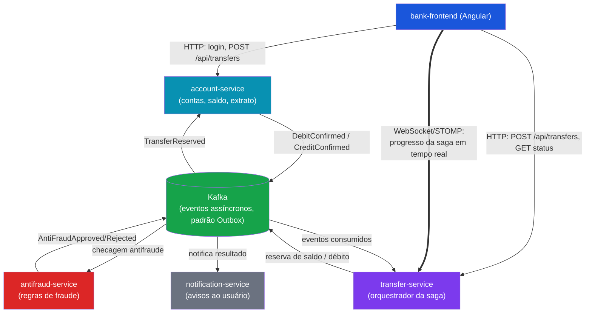

# Banco Digital — Transferências com Saga Pattern

[](https://github.com/lleolopes03/banco-digital-saga/actions/workflows/ci.yml)


Simulação de um banco digital com contas, depósitos e transferências. Toda transferência é orquestrada por uma saga:
reserva de saldo → checagem antifraude → confirmação de débito → crédito no destinatário. Falhas em qualquer etapa
disparam transações compensatórias que devolvem o dinheiro à conta de origem (rollback via saga, não via transação de
banco de dados).

Três microsserviços Spring Boot orquestram a saga da transferência e se coordenam via Kafka (padrão Outbox) sem nenhuma
chamada síncrona entre si; um quarto (`notification-service`) reage ao resultado da saga registrando notificações em
MongoDB. Um frontend Angular acompanha o progresso da saga em tempo real via WebSocket/STOMP, e todo o sistema é
validado a cada push por um pipeline de CI que sobe Postgres, MongoDB, Kafka e Redis efêmeros via Testcontainers.

> Projeto de aprendizado, sem licença de uso definida.

## Demonstração

Uma transferência, do formulário até a conclusão, e uma segunda transferência acima do limite antifraude, mostrando a
compensação da saga (estorno) refletida ao vivo no frontend:


## Destaques técnicos

- **Saga orquestrada com compensação real**: cada etapa (reserva, antifraude, débito, crédito) tem a sua compensação,
  disparada por evento.
- **Padrão Outbox com propagação de trace pelo Kafka**: nenhum evento se perde entre a transação de negócio e a
  publicação, e a saga inteira aparece como **um único trace** no Jaeger.
- **Escala horizontal provada em teste**: poller do Outbox seguro para várias instâncias (`FOR UPDATE SKIP LOCKED`),
  tópicos particionados e consumers em paralelo. Medido em carga: a latência mediana da saga a 12 tx/s caiu de 19,7 s
  para 0,9 s ([resultados](load-tests/README.md)).
- **Resiliência provada por teste**: circuit breaker na única chamada síncrona, dead-letter queue nos consumers,
  idempotência (Redis + fonte de verdade durável), cada mecanismo com teste de integração contra infraestrutura real.
- **Observabilidade**: tracing distribuído (OpenTelemetry → Jaeger), métricas (Micrometer → Prometheus → Grafana) e
  dashboard provisionado automaticamente.
- **API documentada como contrato**: OpenAPI com resumos, respostas reais e exemplos, e um teste que falha se a spec
  divergir do comportamento.
- **Segurança**: JWT com blacklist de logout compartilhada via Redis e autorização por dono da conta.
- **Modelagem poliglota justificada**: PostgreSQL nos serviços transacionais, MongoDB nas notificações
  ([por quê](docs/notificacoes.md)).
- **Código limpo e testado**: responsabilidade única, sem repetição, contratos de evento e de API fixados por teste
  ([princípios](docs/principios-de-design.md)).

## Documentação

| Documento | Conteúdo |
|---|---|
| [Configuração](docs/configuracao.md) | Variáveis de ambiente, propriedades, padrões e portas |
| [Segurança](docs/seguranca.md) | Login, JWT, logout, blacklist e autorização por conta |
| [Resiliência](docs/resiliencia.md) | Circuit breaker e dead-letter queue |
| [Outbox, partições e retenção](docs/outbox-e-escala.md) | Poller, escala horizontal e limpeza de dados |
| [Observabilidade](docs/observabilidade.md) | Tracing, métricas e dashboard |
| [Tempo real](docs/tempo-real.md) | WebSocket/STOMP e o frontend da saga |
| [Antifraude](docs/antifraude.md) | Regras de fraude |
| [Notificações](docs/notificacoes.md) | MongoDB, consumer e consulta |
| [Princípios de design](docs/principios-de-design.md) | SOLID, Clean Code e as decisões de duplicação |
| [CI/CD](docs/ci-cd.md) | Pipeline, gate da saga e deploy |
| [Testes de carga](load-tests/README.md) | Rampa, longa duração e análise de latência |
| [Solução de problemas](docs/solucao-de-problemas.md) | Sintomas conhecidos, causas e correções |
| [Contribuindo](CONTRIBUTING.md) · [Changelog](CHANGELOG.md) | Fluxo de trabalho e histórico de mudanças |

## Stack

- **Backend**: Java 21, Spring Boot 4.1, Maven, PostgreSQL, Flyway, MongoDB (notification-service), Kafka (KRaft),
  Redis, Resilience4j, WebSocket/STOMP, springdoc-openapi
- **Frontend**: Angular 19 standalone, TypeScript, `@stomp/stompjs`, ESLint
- **Testes**: JUnit 5, Mockito, Testcontainers, Karma/Jasmine, módulo `e2e-tests` que sobe os serviços da saga contra
  infraestrutura real
- **Observabilidade**: OpenTelemetry (otel-collector → Jaeger), Micrometer/Prometheus, Grafana
- **CI/CD**: GitHub Actions (lint, testes, build de imagens Docker, deploy no Railway), Spotless, ESLint
- **Infra local**: Docker Compose

> O Spring Boot 4.1 foi adotado porque o start.spring.io não gera mais projetos na linha 3.x (mínimo atual: 4.0).

## Arquitetura



Cada serviço da saga tem o seu PostgreSQL; o `notification-service` usa MongoDB. O Redis é compartilhado para
idempotência dos consumers, cache, rate limit e blacklist do JWT. Os serviços exportam traces para um otel-collector (que
repassa ao Jaeger) e expõem métricas em `/actuator/prometheus`.

### Fluxo da saga de transferência

1. **Reserva de saldo**: o `transfer-service` pede ao `account-service` para reservar o valor na conta de origem.
2. **Checagem antifraude**: o `antifraud-service` avalia a transferência a partir do evento de reserva.
3. **Confirmação de débito**: se aprovada, o `transfer-service` confirma o débito na conta de origem.
4. **Crédito no destinatário**: o `account-service` credita a conta de destino.
5. **Compensação**: se a reserva, o antifraude ou o crédito falharem, o `transfer-service` dispara a transação
   compensatória que devolve o valor à conta de origem. O `notification-service` informa o resultado (sucesso ou
   estorno).

**Falha rápida na reserva:** quando o saldo é insuficiente, o `account-service` publica `TransferReservationFailed`; o
`transfer-service` falha a saga na hora, com o motivo real em `failureReason`, em vez de esperar o timeout de 2 minutos.

## Subindo o ambiente

Pré-requisitos: JDK 21, Docker e Node 22 (para o frontend).

### 1. Infraestrutura

Copie `.env.example` para `.env` (os padrões já funcionam) e suba:

```bash
docker compose up -d
```

Isso sobe Kafka, três PostgreSQL, MongoDB, Redis, Jaeger, otel-collector, Prometheus e Grafana. As portas e as variáveis
estão em [Configuração](docs/configuracao.md); o Grafana abre em `http://localhost:3000` (admin/admin, ou acesso anônimo
como Viewer).

### 2. Backends

Cada serviço roda no profile `dev`, apontando para os containers acima:

```bash
cd account-service
./mvnw spring-boot:run -Dspring-boot.run.profiles=dev
```

Repita para `transfer-service`, `antifraud-service` e `notification-service` (portas `8081` a `8084`).

### 3. Frontend

```bash
cd bank-frontend
npm install
npm run dev
```

Abre em `http://localhost:4200`, com proxy para `account-service` e `transfer-service` (incluindo o WebSocket `/ws`), o
que dispensa CORS.

| Rota | Autenticação | Descrição |
|---|---|---|
| `/login` | Não | Login; redireciona para `/dashboard` |
| `/dashboard` | Sim | Saldo atual e atalhos |
| `/extrato` | Sim | Extrato paginado, com filtro por período |
| `/transferencia` | Sim | Formulário de nova transferência |
| `/transferencia/:transferId/status` | Sim | Acompanhamento ao vivo da saga ([detalhes](docs/tempo-real.md)) |

## API

Cada serviço com endpoint HTTP publica Swagger UI e a spec OpenAPI:

| Serviço | Swagger UI | OpenAPI JSON |
|---|---|---|
| account-service | http://localhost:8081/swagger-ui.html | http://localhost:8081/v3/api-docs |
| transfer-service | http://localhost:8082/swagger-ui.html | http://localhost:8082/v3/api-docs |
| notification-service | http://localhost:8084/swagger-ui.html | http://localhost:8084/v3/api-docs |

O `antifraud-service` não tem API HTTP (participa da saga só por Kafka).

### Endpoints

| Método e caminho | Sucesso | Autenticação | Descrição |
|---|---|---|---|
| `POST /api/auth/login` | 200 | Pública | Autentica e devolve o JWT |
| `POST /api/auth/logout` | 204 | JWT | Revoga o token |
| `POST /api/accounts` | 201 | JWT | Abre uma conta |
| `GET /api/accounts/{id}` | 200 | JWT, dono da conta | Dados da conta |
| `GET /api/accounts/{id}/balance` | 200 | JWT, dono da conta | Saldo (cache de até 30 s) |
| `POST /api/accounts/{id}/deposits` | 200 | JWT, dono da conta | Deposita |
| `GET /api/accounts/{id}/statement` | 200 | JWT, dono da conta | Extrato paginado, com filtro por período |
| `POST /api/transfers` | 202 | JWT, dono da conta de origem | Solicita uma transferência (assíncrona) |
| `GET /api/transfers/{id}` | 200 | JWT | Estado da transferência |
| `GET /api/notifications/{accountId}` | 200 | JWT, dono da conta | Notificações da conta |

`POST /api/transfers` aceita o header opcional `Idempotency-Key`: repetir o pedido com a mesma chave devolve a mesma
transferência. Há também o WebSocket STOMP `/ws` para acompanhar a saga em tempo real.

### Formato de erro

Todos os erros, inclusive os de segurança e de limite de uso, têm o mesmo corpo:

```json
{
  "timestamp": "2026-10-21T14:05:00.123Z",
  "status": 404,
  "error": "Not Found",
  "message": "Conta 7d9f3c52-0a1b-4c3d-8e2f-5a6b7c8d9e0f não encontrada."
}
```

Códigos usados: `400` (dados inválidos), `401` (token ausente, inválido ou revogado), `403` (conta de outro usuário), `404`,
`409` (CPF duplicado ou conflito de concorrência), `422` (saldo insuficiente na pré-checagem) e `429` (limite de
transferências por conta; o header `Retry-After` informa quando tentar de novo).

### Como autenticar

Faça `POST /api/auth/login` com `email` e `senha`, clique em **Authorize** no Swagger UI e cole o token (válido por 15
minutos). Atenção: **não existe endpoint de cadastro de usuário**; o usuário é criado direto no banco (veja
[Segurança](docs/seguranca.md)).

## Testes e qualidade

```bash
./mvnw verify          # em cada serviço: unitários + integração (Testcontainers, precisa do Docker)
cd e2e-tests && mvn verify   # gate ponta a ponta da saga (instale os serviços antes; ver CONTRIBUTING)
cd bank-frontend && npm test
```

- Cada mecanismo de resiliência, idempotência e consistência tem teste de integração contra infraestrutura real.
- **Testes de contrato:** `OpenApiContractTest` compara a spec OpenAPI com o comportamento real, e
  `EventTypeContractTest` fixa o nome dos eventos publicados no Kafka.
- **Carga:** rampa e teste de longa duração em [`load-tests/`](load-tests/README.md).
- Formatação: Spotless (Java) e ESLint (frontend), verificados no CI.

## Estrutura do repositório

```
account-service/        Spring Boot: contas, saldo, extrato e autenticação
transfer-service/       Spring Boot: orquestrador da saga e WebSocket/STOMP
antifraud-service/      Spring Boot: regras de fraude (só Kafka)
notification-service/   Spring Boot: notificações em MongoDB
bank-frontend/          Angular (servido via nginx na imagem Docker)
e2e-tests/              Gate ponta a ponta da saga (caminho feliz e compensações)
load-tests/             Testes de carga e ferramentas de análise de latência
observability/          Configuração do otel-collector, Prometheus e dashboard do Grafana
docs/                   Documentação por tema e o GIF de demonstração
.github/                Pipeline de CI/CD e scripts do workflow
docker-compose.yml      Infraestrutura local
.env.example            Variáveis de ambiente de conexão
CONTRIBUTING.md · CHANGELOG.md
```

Cada `*-service` segue a mesma organização de pacotes (`domain`, `application`, `infrastructure`, `web`); os motivos e as
decisões estão em [Princípios de design](docs/principios-de-design.md).

## CI/CD

O pipeline em [`.github/workflows/ci.yml`](.github/workflows/ci.yml) roda a cada push e pull request: lint, testes de
cada serviço com containers efêmeros, o gate ponta a ponta da saga, build das imagens Docker e, só na `main`, o deploy no
Railway. Um teste quebrado bloqueia o deploy. Detalhes em [CI/CD](docs/ci-cd.md).

## Limitações conhecidas

- **Sem cadastro de usuário:** o usuário é criado direto no banco, e não há refresh token.
- **`GET /api/transfers/{id}` não confere o dono:** qualquer usuário autenticado consulta qualquer transferência pelo id.
- **Notificações sem envio real:** o serviço registra a notificação, mas não envia e-mail, SMS nem push.
- **Cauda de latência:** a ~3% das sagas esperam acima de 800 ms no primeiro salto sob carga; a causa não foi
  identificada (descartados GC, checkpoint do Postgres, rebalance e falha de consumer).
- **Escala horizontal:** o poller do Outbox foi provado seguro para várias instâncias em teste de integração, não em
  carga com várias JVMs.
- **Código duplicado entre serviços:** deliberado (cada serviço é um deploy independente); com mais serviços, o passo
  natural é um módulo compartilhado.

## Contribuindo

Veja o [guia de contribuição](CONTRIBUTING.md) e o [changelog](CHANGELOG.md).
