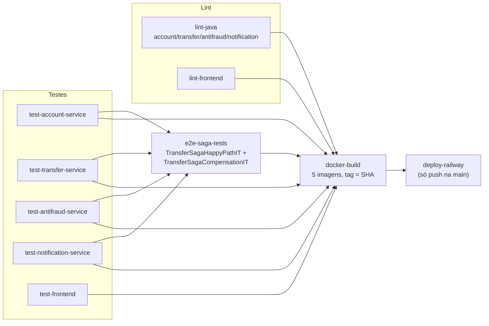

# CI/CD

[← Voltar ao README](../README.md)

Pipeline completo em [`.github/workflows/ci.yml`](../.github/workflows/ci.yml), disparado a cada
push e a cada pull request. Nenhum job depende do `docker-compose.yml` local — todo container
(Postgres, MongoDB, Kafka, Redis) é efêmero, criado pelo próprio Testcontainers dentro do runner
do GitHub Actions.

- **Lint/format**: `spotless:check` (Java, regras leves — import order, imports não usados,
  espaço em branco) nos quatro serviços; `ng lint` (ESLint + `angular-eslint`) no frontend.
- **Testes por serviço**: `./mvnw verify` roda unitários (Surefire) e de integração (Failsafe)
  no mesmo job — cada serviço usa `@Testcontainers` + `@ServiceConnection` (ver
  `AbstractIntegrationTest` de cada um) para subir sua infra real automaticamente (Postgres/
  Kafka/Redis nos três serviços da saga; Mongo/Kafka/Redis no notification-service), sem nenhuma
  configuração extra no runner. `bank-frontend` roda Karma/Jasmine em `ChromeHeadless`.
- **Gate final da saga (`e2e-saga-tests`)**: instala os quatro serviços como jar no repositório
  Maven local do runner (`mvn install -DskipTests` — os testes de cada um já rodaram nos jobs
  acima) e roda `mvn verify` no módulo `e2e-tests`, que sobe os quatro `ApplicationContext`
  Spring na mesma JVM contra Postgres/MongoDB/Kafka/Redis via Testcontainers e executa
  `TransferSagaHappyPathIT` e `TransferSagaCompensationIT` de ponta a ponta. **Se
  `TransferSagaCompensationIT` quebrar, este job falha e nada depois dele roda** — nem o build de
  imagens, nem o deploy. É a garantia mais importante do pipeline. `TransferSagaHappyPathIT`
  também confirma, no final, que a saga concluída vira uma `Notification` real no
  notification-service (consultada via HTTP contra o MongoDB efêmero do próprio teste) — fecha o
  ciclo completo, não só o caminho transacional da saga.
- **Build de imagens**: só roda depois que lint + todos os testes + o gate da saga passarem.
  Cada imagem (`account-service`, `transfer-service`, `antifraud-service`, `notification-service`,
  `bank-frontend`) é taggeada com o SHA do commit; em push na `main`, também publica no GitHub
  Container Registry (`ghcr.io`, usando o `GITHUB_TOKEN` padrão do Actions — nenhum secret extra
  necessário só para isso).
- **Deploy (Railway)**: só em push na `main`, só depois de tudo acima ter passado. Depende do
  secret `RAILWAY_TOKEN` (Settings → Secrets and variables → Actions no GitHub) — sem ele
  configurado, o job registra um aviso e sai sem falhar, em vez de quebrar o pipeline.
- **Sem secrets no repositório**: toda credencial (`JWT_SECRET` de produção, `RAILWAY_TOKEN`,
  etc.) vem de GitHub Secrets. O único valor "sensível" versionado é um segredo JWT de
  desenvolvimento explicitamente nomeado `...-desenvolvimento-nao-usar-em-producao` como default
  de fallback local (`${JWT_SECRET:...}`), sobrescrito por variável de ambiente em qualquer
  ambiente real.
